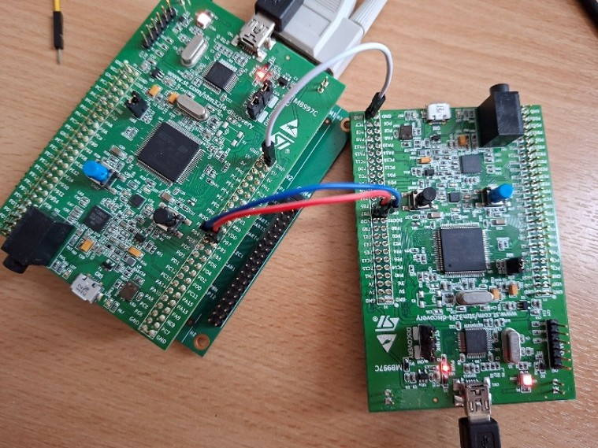
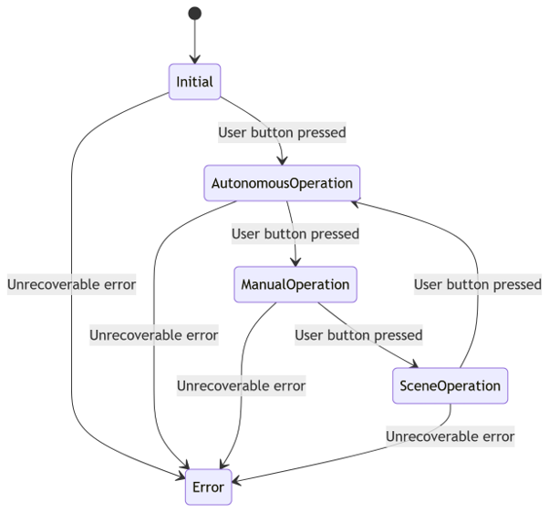

# STM32 Smart Blinds

## Overview

The prototype runs on two STM32F4 Discovery Kits and simulates smart blinds. The system uses a state machine architecture with each state acting as a mode of operation.
The Initial state allows configuration. Users will set max/min voltages accepted from a light-dependent resistor (LDR), set a damping period controlling motor movement duration, hysteresis values to reduce jitter, and scene state settings like target angle and when it switches between target angle and blinds open. 
The three states for blind operation are: 
- **Autonomous state:** Control blind position based on input from an LDR.
- **Manual state:** Blind position controlled by button presses on a target device connected by I2C, which gives position data. 
- **Scene state:** Based on two RTC alarms that alternate blind position from a user selected angle to open.

Button presses are used to transition between states. If an unrecoverable error occurs, the program enters the error state, where it remains until reset.

## State Architecture

Once configured, pressing the blue user button transitions between states, starting in autonomous state, then manual state, and finally scene state before rotating back to autonomous.
If unrecoverable errors occur, the prototype enters the error state, and the black reset button needs to be pressed and configuration re-entered.
The following LED patterns show which state is currently active:

| State | LED Pattern |
|---|---|
| Initial | Solid Orange |
| Autonomous | Chase Clockwise |
| Manual | Flashing Blue |
| Scene | Flashing Green |
| Error | Flashing Red |

## Implementation Details

### PWM Motor Control, Damping and Hysteresis
Motor control was implemented using pulse width modulation, with pulse widths of 0.5ms-2.5ms and frame sizes of 20ms. 
Thus, the duty cycle could be changed from 2.5% to 12.5%. 
A damping period, configured by users, creates smaller fractional steps that the motor rotates through, ensuring smooth movement. 
One downside is the blinds move faster when the new target angle is far away, which looks irregular. 
Large damping periods mitigate this, but slow down smaller target angle changes unnecessarily. 
Hysteresis bands, also user configured, are used to reduce motor jitter as light values constantly change. 
This simply checks new target pulse widths are different enough to be significant. This does reduce accuracy of light-level to motor movement, but greatly increases blind stability, decreasing user annoyance.

### Light Sensing
An LDR was used to collect raw analogue data and then converted to digital by the inbuilt ADC. 
Values were inverted as voltages displayed would rise when brighter and this felt more intuitive to users.

### GPIO and Buttons
Two buttons on the board were used, the user button for transitioning between states, and the reset which is pre-configured. 
The user button was read with the IDR register and debounced with an algorithm that locks the button state when it changes for 20ms ensuring no noise is recorded.

### USART and Serial
Terminal Output was set up by initialising serial IO and implementing weak getchar() and putchar() functions. 
Backspace does not function however as it simply prints received characters. 
This is mitigated by the program handling input validation well, just asking for input again if incorrect values are entered.

### RTC and LEDs
The RTC was enabled with two alarms configured to trigger changes in the scene state.
LED output was initialised and lights enabled/disabled by editing the Output Data Register (ODR).

### Overall Design Decisions

Startup configuration allows the user to enter values, with inputs validated by checks. 
These include whitespace checking, value type checks, variable range checks, and min/max checks.
Data was stored as integers mostly, reducing computational overhead and floating-point precision errors. 
The only exception was pulse width, as helper functions were designed to convert to/from ms.
The system uses polling for most feature implementations requiring additional CPU overhead over interrupts. 
The polling was designed to complete within a 20ms cycle to ensure time-critical operations could be serviced appropriately.
Polling also decreases risk of interrupt storms.

## Hardware Requirements

For full operation, the user needs:

- Two STM32F4 Discovery kits (one controller with expansion board, one target)
- USB A-Serial (RS232) Converter
- Null modem connector (Serial-Serial (RS232))
- Two USB A-USB B Mini cables
- MG90S micro servo
- Light-dependent resistor (LDR) (Demonstrated with VEX V5 Light Sensor)
- One Dupont Jumper Male-Female wire
- Two Dupont Jumper Male-Male wires
- Six Dupont Jumper Female-Female wires
- Three Dupont Jumper-Banana wires
- Bench power supply

## Hardware Setup

First, set up the hardware. 
Using a USB A-USB B Mini, connect the USB A to a computer, and the USB B Mini to the power slot on the end of your controller board. 
Do the same for your target board. 

Next, connect the null modem RS232-RS232 into the serial end of the USB A-RS232 connector and into the RS232 port of the expansion board on the controller board. 
Then plug the USB A end of the USB-RS232 into your computer.

Motor connection is achieved by plugging two male-male jumper cables into the red and black wires terminating in a 3-wire female jumper connector. 
After, plug the male jumper coming out the red wire to a jumper cable to banana cable and place into the power port on the bench power supply. 
Do the same for the black cable, connecting to the ground of the power supply.

Connect the yellow wire on the 3-wire connector with a male-female jumper wire and insert the female end into pin PE5. 
Then with another jumper-banana wire, connect a GND pin with the jumper end, and the banana into the ground port of the power supply by stacking the banana cables. 
This ensures the servo and controller share a common ground.

On the bench power supply, ensure that voltage is set to 5.0V and no more as this is the maximum voltage for the servo. 
The example power supply is an EX354RD from Aim-TTi, and provides up to 35V, so set voltages at appropriate levels to ensure no damage.

Connecting the LDR comes next. 
Three female-female jumper cables are used. 
Connect one end to the red power wire of the LDR’s 3-pin male connectors and then into the 3V port of the controller board. 
Next, connect the black wire to the GND of the controller board, and the white cable to pin PA1.

Finally, the target board must be connected into the controller board to enable I2C communication. 
This requires 3 female-female jumper cables. Connect pin PB6 to PB6, PB7 to PB7 and GND to GND on both boards to connect.
	
## Firmware Configuration

Open a serial terminal to see output from the board and enter configuration. 
Pressing the black button will restart the program and display the first configuration options.

Select acceptable ranges for the LDR in voltages between 0V and 3.3V with suggested values being min:1.6, max:2.0.
This requires figuring out your environment's light level, as different environments have different light levels.

Damping period (s) is next. 
This determines the amount of time for the blinds to move to the required position. 
Ranges of 0-6s are acceptable with 4s recommended.

Next, enter hysteresis band values in voltages. 
These create dead zones, so the blinds are not overly sensitive to light fluctuations. 
With a range of 0.1V to 1.0V, lower selections work well, like 0.3V.

Finally, the scene state is configured. 
The user is asked for values between 0° (open) and 180° (closed) which set the target angle for their scene. 
Afterwards, the user sets the time to open blinds and to move to the target angle. 
Each element is collected separately, hours, minutes, and seconds.

Now the firmware is configured and the values are stored. The program is ready for operation.

## Building and Running

### Controller Board

Using STM32CubeIDE open and build the project, and with your controller STM32F4 Discovery board flash the firmware using the onboard ST-LINK debugger.
Then connect all hardware except target board and I2C connections.

### Target Board

The target board runs supplied precompiled firmware.
The binary is not included in this repo. 
All functionality is still usable without the target board firmware, as the controller board can operate independently except the use of manual mode which requires the target firmware.

### Final Setup

Now with both boards (or just the controller) set up press reset first on the target (if applicable) and then the controller. Set up a serial terminal with the following settings:

115200 baud, 8 data bits, no parity, 1 stop bit, and no flow control.

Use the terminal to configure the firmware as described above. 
After configuration, the blue button cycles between states.